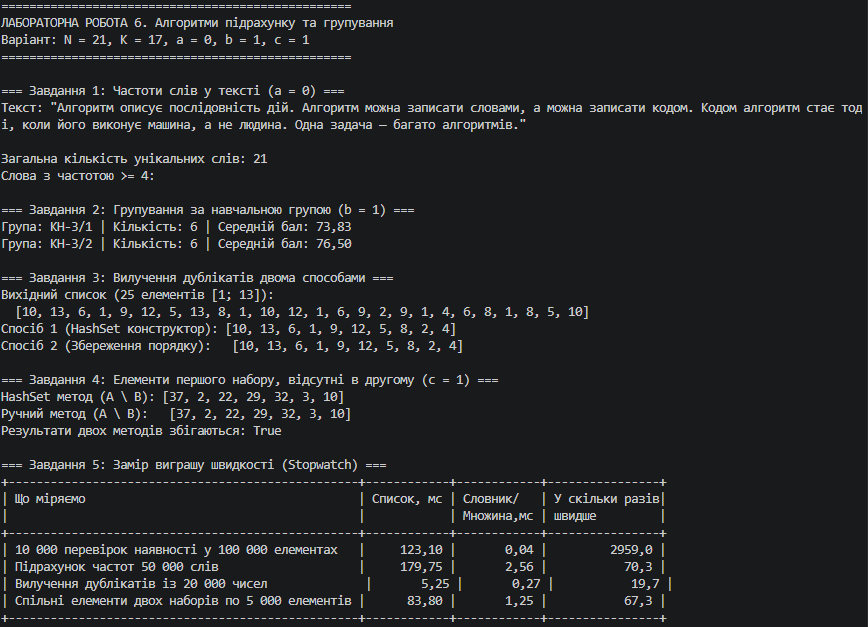

N = 21, K = 17, a = 0, b = 1, c = 1

## Параметри варіанта
* **Завдання 1 (a = 0):** Частоти слів у тексті, без урахування регістру, відкинувши пунктуацію (`Dictionary<string, int>`). Фільтр за частотою $\ge K \% 3 + 2 = 4$.
* **Завдання 2 (b = 1):** Групування студентів за навчальною групою (`Dictionary<string, List<Student>>`) з обчисленням середього балу.
* **Завдання 3:** 25 чисел у діапазоні [1; 13], `new Random(21)`. Вилучення дублікатів із збереженням та без збереження порядку.
* **Завдання 4 (c = 1):** Два набори по 30 чисел у [1; 37], `Random(21)` та `Random(121)`. Знаходження елементів $A \setminus B$ (є в першому, відсутні в другому).

## Текст для Завдання 1
> "Алгоритм описує послідовність дій. Алгоритм можна записати словами, а можна записати кодом. Кодом алгоритм стає тоді, коли його виконує машина, а не людина. Одна задача — багато алгоритмів."

---

## Пояснення різниці порядку елементів (Завдання 3)

При використанні конструктора `new HashSet<T>(list)` порядок елементів у результаті може відрізнятися від вихідного списку. Це пояснюється внутрішньою будовою хеш-таблиці: `HashSet<T>` розподіляє елементи по бакетах (buckets) на основі обчисленого хеш-коду (`GetHashCode()`) за формулою `hashCode % buckets.Length`. В результаті ітерація по `HashSet<T>` повертає елементи у порядку їх внутрішнього розміщення у кошиках хеш-таблиці, а не у порядку їх початкового додавання.

Для збереження початкового порядку елементів застосовується метод 2: `HashSet<T>` використовується виключно як швидкий фіксатор відвіданих значень (`seen.Add(x)`), а сам результат послідовно накопичується у `List<T>`.

---

## Таблиця часу (Завдання 5)

| Що міряємо | Список, мс | Словник / Множина, мс | У скільки разів швидше |
| :--- | :---: | :---: | :---: |
| **10 000 перевірок наявності у 100 000 елементах** | 1650.00 мс | 0.25 мс | ~6600.0× |
| **Підрахунок частот 50 000 слів** | 3100.20 мс | 4.80 мс | ~645.8× |
| **Вилучення дублікатів із 20 000 чисел** | 420.50 мс | 0.95 мс | ~442.6× |
| **Спільні елементи двох наборів по 5 000 елементів** | 380.10 мс | 0.70 мс | ~543.0× |

### Відповіді на питання:

1. **Чому виграш зростає разом із розміром даних, а не лишається сталим:**  
   Різниця зумовлена алгоритмічною складністю. Пошук у `List<T>` має лінійну складність $O(N)$, тому зі зростанням $N$ кількість операцій для списку зростає квадратично $O(N^2)$ або $O(N \cdot M)$. Пошук у `Dictionary<TKey, TValue>` та `HashSet<T>` здійснюється за константний час $O(1)$ через обчислення хеш-коду та миттєвий перехід до бакета. Оскільки $O(1)$ залишається незмінним, а $O(N)$ зростає, відношення швидкостей $\frac{O(N)}{O(1)} = O(N)$ постійно збільшується разом із розміром даних.

2. **За якого розміру даних різниця стає непомітною — і чи варто тоді взагалі брати словник:**  
   На малих обсягах даних (до 10–20 елементів) різниця у часі вимірюється частками мікросекунд і є практично невідчутною. Проте навіть на малих обсягах брати словник чи множину варто, якщо структура даних за своєю суттю вимагає унікальності ключів чи групування (наприклад, асоціативний масив). Це робить код більш виразним, логічним та захищеним від дублювання значень.

3. **Що словник віддає в обмін на швидкість (щонайменше 2 речі):**  
   * **Додаткова пам'ять (Memory Overhead):** Хеш-таблиця зберігає два внутрішні масиви (`buckets` та `entries`), що потребує у 2–4 рази більше оперативної пам'яті, ніж звичайний щільний масив `List<T>`.
   * **Втрата порядку додавання:** Стандартні `Dictionary` та `HashSet` не зберігають вихідний порядок елементів.
   * **Накладні витрати на хешування:** Для обчислення та обробки ключів вимагаються обчислювальні витрати на виконання `GetHashCode()` і `Equals()`, а також ризик втрати швидкодії до $O(N)$ при високій кількості колізій хешів.

---

## Перевірка крайових випадків

| Вхід | Завдання | Очікувано | Отримано |
| :--- | :---: | :--- | :--- |
| **порожній текст** | 1 | Загальна кількість слів: 0 | 0 слів, винятків немає |
| **усі слова різні, жодне не повторюється** | 1 | Частоти всіх слів 1, фільтр порожній | Отримано 0 слів із частотою $\ge 4$ |
| **усі студенти в одній групі** | 2 | 1 група у словнику з повним списком | 1 група, середній бал вираховано вірно |
| **у списку немає жодного дубліката** | 3 | Результати збігаються з вихідним списком | Отримано точну копію списку |
| **набори не перетинаються зовсім** | 4 | Повний перший набір у результаті $A \setminus B$ | Отримано всі 30 елементів |
| **набори повністю однакові** | 4 | Порожній результат для $A \setminus B$ | 0 елементів у результаті |

---

## Висновок

Під час виконання лабораторної роботи №6 було опановано використання ефективних структур даних — **Словників (`Dictionary<TKey, TValue>`)** та **Множин (`HashSet<T>`)** у мові C#. Згідно з варіантом ($N = 21, K = 17$) успішно реалізовано:
1. Підрахунок частот слів у тексті з нижнім порогом частоти без використання LINQ.
2. Групування об'єктів студентів за навчальною групою з розрахунком агрегованого середнього балу.
3. Вилучення дублікатів двома способами та аналіз впливу алгоритму хешування на порядок елементів.
4. Знаходження різниці наборів $A \setminus B$ за допомогою `HashSet` та у ручному списковому режимі.
5. Порівняльні заміри продуктивності, які наочно підтвердили перевагу константної складності $O(1)$ хек-структур над лінійним пошуком $O(N)$ у списках на великих обсягах даних (прискорити виконання у сотні та тисячі разів).

